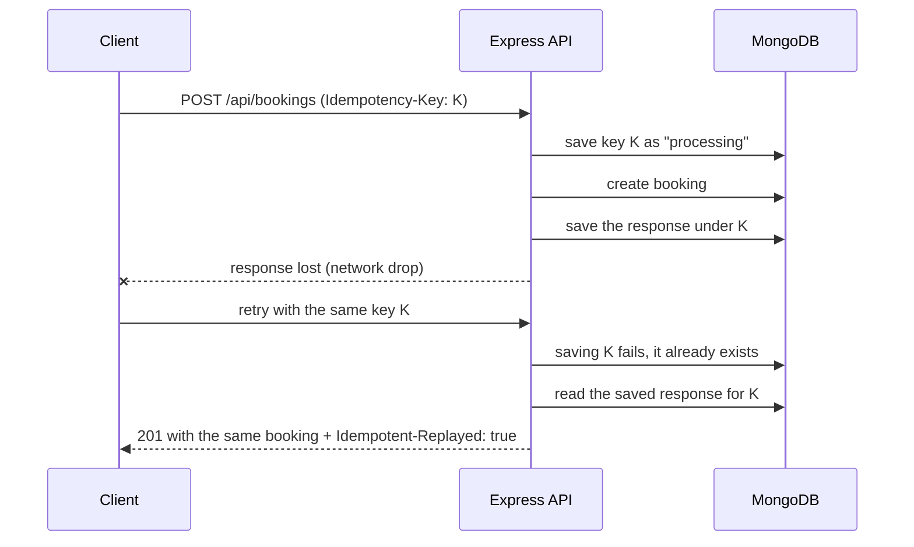
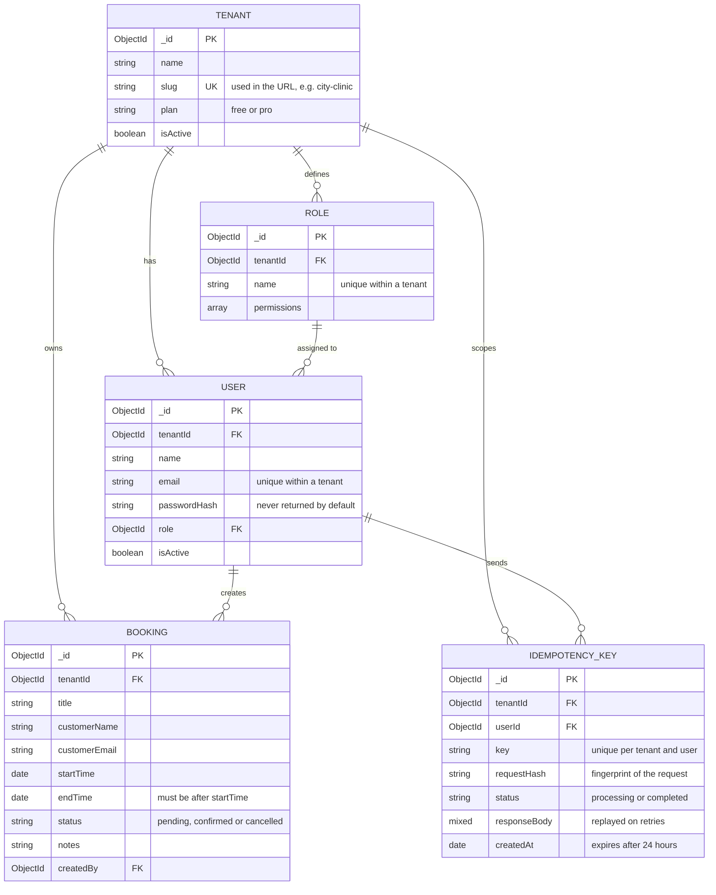
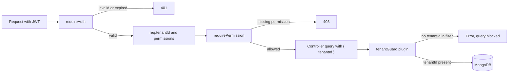

# Tessera

A multi-tenant booking platform for small businesses like clinics, salons and gyms. Each business gets its own private space for its team and bookings, all running on one shared app.

Built during the Parallax Labs Full-Stack Developer Internship (Track B, 6 weeks).

## Why the name "Tessera"

A **tessera** is a single tile in a mosaic. Hundreds of them sit side by side to make one picture, but each tile stays whole and separate.

That's exactly how this app works:

- Every business on Tessera is one tile, with its own users, roles and bookings
- All the tiles together make up the platform
- No tile can see into another, which is the core idea of multi-tenancy

The visual design follows the same idea. The tile pattern on the auth screens and the strip along the app's edges are inspired by **ajrak**, the hand block-printed textile from Sindh, where a single carved block is stamped again and again to build the full pattern.

## Tech stack

- **Frontend:** React (Vite), React Router, Tailwind CSS v4, Zod
- **Backend:** Node.js, Express 5, Mongoose, Zod, JSON Web Tokens, bcryptjs
- **Database:** MongoDB 7, running in Docker
- **Tooling:** Docker Compose, nodemon, Postman

## Weekly progress

- **Week 1:** Project architecture, multi-tenant schema, tenant isolation, RBAC, auth API and auth UI ✅
- **Week 2:** Idempotent booking APIs, strict validation, standard errors, Postman collection, booking calendar UI with create, edit and delete, toasts and retry logic ✅

## Week 2: what I built

**Backend**

- Full booking API: list (with date range and status filters), view, create, update and delete
- Strict Zod validation that rejects unknown fields, so a request can never set its own `tenantId` or `createdBy`
- One standard error format for every error the API can return
- Idempotency keys on booking creation, so a retried request can never create a second booking
- A Postman collection documenting every endpoint, including idempotent retries and error cases

**Frontend**

- Bookings page with a **week calendar** and a **list view**
- Click an empty time slot to create a booking at that time
- Booking details with edit, delete (with confirmation) and one-click confirm for pending bookings
- One shared form for create and edit, with client-side Zod validation that mirrors the server rules
- Toast notifications for success and failure, with a **Try again** action when a request fails
- Automatic retry with exponential backoff for temporary failures
- Mobile layout: the calendar switches to one day at a time with a day picker, and popups become bottom sheets
- Edit and delete buttons follow the signed-in user's role permissions

## Week 2: how I approached it

**One error shape everywhere.** Every error from the API looks the same:

```json
{
  "error": {
    "code": "VALIDATION_ERROR",
    "message": "Some fields are invalid",
    "details": [{ "field": "endTime", "message": "End time must be after start time" }]
  }
}
```

The frontend checks `code`, which never changes, instead of matching message text. `details` only appears on validation errors, one item per field, so the form can show each message under the right input. Controllers and middleware just `throw new AppError(status, code, message)`, and one error handler turns every error into this shape.

**Strict validation as a security layer.** The booking schemas use Zod's `.strict()`, so any field that isn't expected is rejected with a `400`. Sending `tenantId` in the body to try to write into another organisation fails validation before it reaches the database. The tenant always comes from the signed-in user's token.

**Idempotency for safe retries.** The risky case is a create request that succeeds on the server but whose response is lost on the way back. The client retries and, without protection, a second booking is created.

The client sends an `Idempotency-Key` header, a random ID made once per user action and reused for every retry of that action. The server stores each key with a fingerprint of the request body and the response it sent:



- Same key, same body → the saved response is sent again, nothing new is created
- Same key, different body → `422 IDEMPOTENCY_KEY_REUSED`
- Same key while the first request is still running → `409 IDEMPOTENCY_IN_PROGRESS`
- Server error (`5xx`) → the key is released so the client can retry properly

The key is saved with a unique index on tenant, user and key, so two retries arriving at the exact same moment can't both get through. Keys expire after 24 hours through a MongoDB TTL index.

**Retry only what's safe to retry.** The frontend retries automatically (twice, waiting 0.5s then 1s) only when the problem is temporary: no connection, or `502`, `503`, `504`. It never retries `4xx` errors, because the same wrong request gets the same answer. `GET` and `DELETE` are always safe to retry. `POST` and `PATCH` are retried only when they carry an idempotency key. If a retried `DELETE` returns `404`, the first attempt already worked, so it counts as success. When all retries fail, a toast offers **Try again**, which reuses the same key.

**Times in UTC, shown in local time.** The API stores and returns ISO dates in UTC. The browser converts them for display and converts form input back to UTC before sending, so bookings show correctly for anyone in any timezone.

## Week 1: how I approached it

**Isolation in code, not by trust.** MongoDB has no row-level security like PostgreSQL, so isolation has to live in the application. A Mongoose plugin (`tenantGuard`) runs before every query on tenant-owned models. If a query has no `tenantId`, it throws an error and never reaches the database. A forgotten filter becomes a visible error, not a silent data leak.

**The tenant comes from the token, never from the request.** When a user logs in, their JWT carries their `tenantId`. The auth middleware verifies the token, loads the user from the database and attaches `req.tenantId`. Routes use that value, so a user can't pick a different tenant by changing the URL or body.

**Cross-tenant requests look like missing data.** If City Clinic sends the ID of a Glow Salon booking, the query includes both the booking ID and the clinic's `tenantId`, so nothing matches and the API returns `404`. It never confirms the booking exists.

**Email is unique per tenant, not globally.** The same person can work at two businesses with the same email and have two separate accounts. Login asks for the organisation URL first, like choosing a Slack workspace.

**Roles hold permissions.** Each role has a list like `bookings:read` or `bookings:delete`, and routes check for the specific permission they need. Adding a role later means adding a list, not changing code.

**Safe onboarding without transactions.** Creating an organisation makes a tenant, two roles and the first admin. MongoDB transactions need a replica set, so the onboarding handler deletes the tenant and roles if a later step fails.

**Same login error for every failure.** Wrong organisation, email or password all return the same message, so the login form can't be used to find out which accounts exist.

## Data model

Every model except Tenant carries a `tenantId`. That field is the isolation boundary.



## Tenant isolation boundaries



## Getting started

### Prerequisites

- Node.js 20 or higher
- Docker Desktop (running)
- Git

### 1. Clone and start MongoDB

```bash
git clone https://github.com/UroojFatima-052/parallax-saas.git
cd parallax-saas
docker compose up -d
```

### 2. Set up the backend

```bash
cd server
npm install
cp .env.example .env
```

On Windows CMD, use `copy .env.example .env` instead of `cp`.

Generate a secret for `JWT_SECRET` and paste it into `server/.env`:

```bash
node -e "console.log(require('crypto').randomBytes(32).toString('hex'))"
```

Fill the database with test data and start the server:

```bash
npm run seed
npm run dev
```

The API runs at `http://localhost:5000`. Check `http://localhost:5000/api/health`.

### 3. Set up the frontend

In a second terminal:

```bash
cd client
npm install
cp .env.example .env
npm run dev
```

Open `http://localhost:5173`.

### 4. Try the API in Postman

Import `docs/tessera.postman_collection.json` into Postman. Run **Login (admin)** first, it saves the token for every other request. **Create booking** generates a fresh idempotency key and saves the new booking's ID, so **Retry create**, **Get**, **Update** and **Delete** work without copying anything.

## Test accounts

All seeded users have the password `Password123!`.

- **City Clinic** (`city-clinic`): `ayesha@cityclinic.test` (admin), `bilal.ahmed@mail.test` (member), `sana@cityclinic.test` (member)
- **Glow Salon** (`glow-salon`): `mehwish@glowsalon.test` (admin), `rabia@glowsalon.test` (member)
- **FitZone Gym** (`fitzone-gym`): `danish@fitzone.test` (admin), `bilal.ahmed@mail.test` (member)

The seed includes two cross-tenant cases on purpose:

- **Shared staff:** Bilal works at City Clinic and FitZone Gym with the same email. He has two separate accounts, and the organisation he signs into decides what he sees
- **Shared customer:** Fatima Noor has a blood test at City Clinic and a facial at Glow Salon. Each business only sees its own booking with her

Seeded bookings are placed in the days after you run the seed, so they always show in the current or next week.

## Verifying isolation

With the database seeded, run from `server`:

```bash
npm run verify
```

It checks that scoped queries return only one tenant's data, that queries without a `tenantId` are blocked, that one tenant can't read another tenant's booking even with its exact ID, and that the shared customer and shared staff cases stay separate.

## API endpoints

**Auth** (public)

- `POST /api/auth/onboard` creates an organisation, its roles and the first admin. Returns a token
- `POST /api/auth/register` joins an existing organisation as a member. Returns a token
- `POST /api/auth/login` signs in with organisation URL, email and password. Returns a token

**Bookings** (requires `Authorization: Bearer <token>`)

- `GET /api/bookings?from=&to=&status=` lists the tenant's bookings, optionally within a date range or by status. Needs `bookings:read`
- `POST /api/bookings` creates a booking. Needs `bookings:create` and an `Idempotency-Key` header
- `GET /api/bookings/:id` returns one booking with the creator's name. Needs `bookings:read`
- `PATCH /api/bookings/:id` updates any booking fields. Needs `bookings:update`. `Idempotency-Key` is optional
- `DELETE /api/bookings/:id` deletes a booking. Needs `bookings:delete`, so members get `403`

**Other**

- `GET /api/health` returns `{ "status": "ok" }`

### Error codes

| Status | Code | When |
| --- | --- | --- |
| 400 | `VALIDATION_ERROR` | A field is missing, invalid, or not allowed |
| 400 | `INVALID_JSON` | The request body isn't valid JSON |
| 400 | `INVALID_ID` | An ID in the URL isn't in a valid format |
| 400 | `IDEMPOTENCY_KEY_REQUIRED` | Creating a booking without an `Idempotency-Key` |
| 400 | `INVALID_IDEMPOTENCY_KEY` | The key is shorter than 8 or longer than 100 characters |
| 401 | `UNAUTHORIZED` | No token, or the account no longer exists |
| 401 | `SESSION_EXPIRED` | The token is invalid or expired |
| 401 | `INVALID_CREDENTIALS` | Wrong organisation, email or password |
| 403 | `FORBIDDEN` | The user's role doesn't have the needed permission |
| 404 | `BOOKING_NOT_FOUND` | No such booking in the signed-in organisation |
| 404 | `ORG_NOT_FOUND` | Registering into an organisation that doesn't exist |
| 404 | `ROUTE_NOT_FOUND` | No route matches the method and URL |
| 409 | `SLUG_TAKEN` | The organisation URL is already used |
| 409 | `EMAIL_TAKEN` | The email already has an account in that organisation |
| 409 | `IDEMPOTENCY_IN_PROGRESS` | A request with this key is still being processed |
| 422 | `IDEMPOTENCY_KEY_REUSED` | The key was already used with a different request body |
| 500 | `INTERNAL_ERROR` | Something unexpected failed on the server |

## Project structure

```
parallax-saas/
├── client/                    React frontend
│   └── src/
│       ├── api/               apiRequest with retry logic and idempotency keys
│       ├── components/        layout, calendar, list, booking form and details, modal, toasts, ajrak pattern
│       ├── context/           toast context
│       ├── hooks/             useToast, useMediaQuery
│       ├── pages/             auth pages and the bookings page
│       └── utils/             dates, validation, slugify, session
├── server/                    Express backend
│   └── src/
│       ├── config/            env validation, database connection
│       ├── controllers/       auth and booking logic
│       ├── middleware/        auth, idempotency, error handler
│       ├── models/            Tenant, Role, User, Booking, IdempotencyKey
│       ├── plugins/           tenantGuard
│       ├── routes/            auth and booking routes
│       ├── seed/              seed and isolation verification scripts
│       ├── utils/             JWT helpers, AppError
│       └── validators/        booking Zod schemas
├── docs/                      Postman collection
└── docker-compose.yml         MongoDB
```

## Known limitations

Deliberate trade-offs, planned for later weeks:

- **No overlap check between bookings:** two bookings can share a time slot, since a clinic or salon often has several staff working at once. Per-staff availability needs a resource or staff model first
- **Bookings stay within one day:** the form sets one date with a start and end time, so a booking can't run past midnight
- **Old tokens stay valid until they expire:** signing in again issues a new token but doesn't cancel the old one, and there's no "log out everywhere" yet. A `tokenVersion` on the user would allow revoking tokens
- **Token in localStorage:** simple to work with, but readable by JavaScript if the site ever had an XSS bug. An `httpOnly` cookie would be safer
- **Open registration:** anyone who knows an organisation's URL can join it as a member. A real product would use invite links
- **Password reset is UI only:** the request screen works, but no email is sent yet
- **No transactions:** onboarding cleans up manually on failure instead of using MongoDB transactions, which need a replica set
- **Subdomains are a preview only:** the `slug.tessera.app` address is shown in the UI, but routing by subdomain comes later