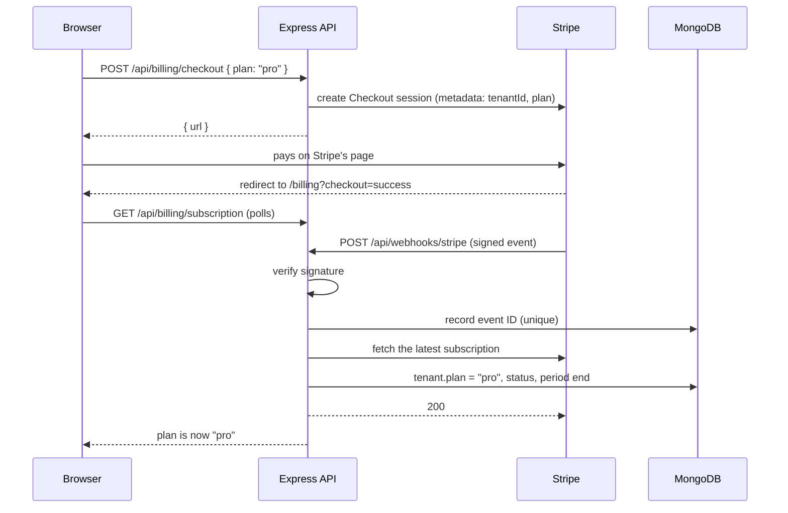
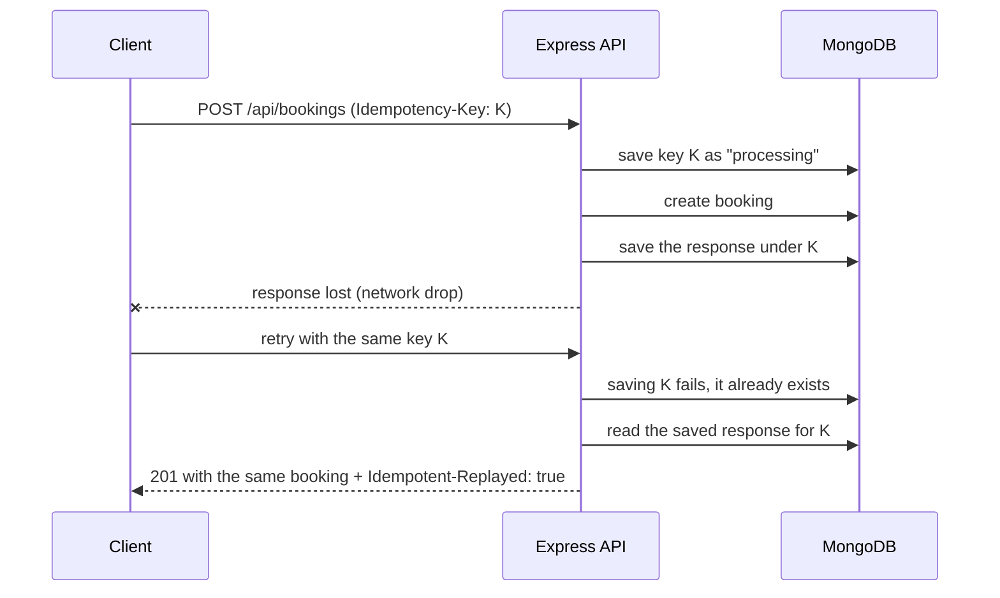
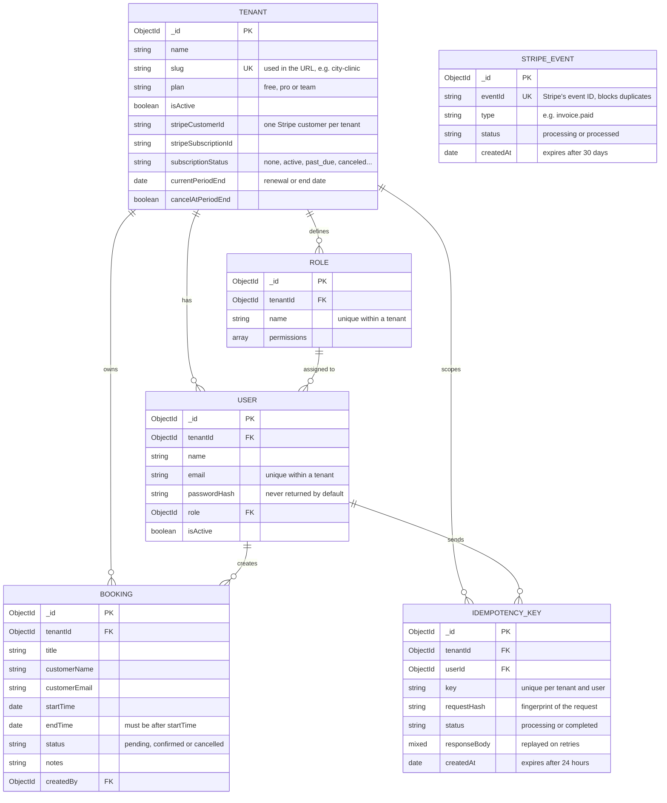
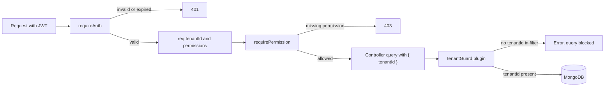

# Tessera

A multi-tenant booking platform for small businesses like clinics, salons and gyms. Each business gets its own private space for its team and bookings, all running on one shared app.

Built during the Parallax Labs Full-Stack Developer Internship (Track B, 6 weeks).

## Why the name "Tessera"

A **tessera** is a single tile in a mosaic. Hundreds of them sit side by side to make one picture, but each tile stays whole and separate.

That's exactly how this app works:

- Every business on Tessera is one tile, with its own users, roles and bookings
- All the tiles together make up the platform
- No tile can see into another, which is the core idea of multi-tenancy

The visual design follows the same idea. The tile pattern on the auth screens and the strip along the app's edges are inspired by **ajrak**, the hand block-printed textile from Sindh, where a single carved block is stamped again and again to build the full pattern.

## Tech stack

- **Frontend:** React (Vite), React Router, Tailwind CSS v4, Zod
- **Backend:** Node.js, Express 5, Mongoose, Zod, JSON Web Tokens, bcryptjs
- **Payments:** Stripe (test mode): Checkout, Subscriptions, Invoices and webhooks
- **Database:** MongoDB 7, running in Docker
- **Tooling:** Docker Compose, nodemon, Postman, Stripe CLI

## Weekly progress

- **Week 1:** Project architecture, multi-tenant schema, tenant isolation, RBAC, auth API and auth UI - Done
- **Week 2:** Idempotent booking APIs, strict validation, standard errors, Postman collection, booking calendar UI with create, edit and delete, toasts and retry logic - Done
- **Week 3:** Stripe subscriptions, verified webhooks with duplicate handling, pricing page with Checkout, billing page with invoice history, plan upgrade, downgrade and cancel - Done

## Week 3: what I built

**Backend**

- Three plans, **Free**, **Pro** ($19/month) and **Team** ($49/month), defined in one place on the server
- Stripe Checkout for starting a paid subscription. Each organisation gets one Stripe customer
- A webhook endpoint that verifies Stripe's signature, skips events it has already processed, and keeps each organisation's plan in sync with Stripe
- Change plan with proration, cancel at the end of the billing period, and undo a cancellation
- Invoice history read from Stripe, with a readable reason for each invoice
- Billing actions need the new `billing:manage` permission, which only admins have

**Frontend**

- **Pricing page** (`/billing/plans`) showing all three plans, the current one marked. Buttons change with the situation: upgrade through Checkout, switch between paid plans, downgrade to Free (with confirmation), or "Ask your admin" for members
- **Billing page** (`/billing`) with the current plan, its status (Active, Cancelling, Payment failed), the renewal or end date, cancel and "Keep my plan", and the invoice history with links to Stripe's hosted invoice and PDF
- After paying, the billing page shows "Confirming your payment" and checks until the webhook has applied the new plan, so the user never lands on a page that still says Free
- Banners for a pending cancellation and for a failed payment
- Billing actions send idempotency keys, so a retried click can't start a second checkout or a second plan change

## Week 3: how I approached it

**Stripe is the source of truth, the webhook keeps us in sync.** The app never marks an organisation as paid just because the browser came back from Checkout, since anyone can open the success URL. The plan only changes when Stripe sends a signed webhook:



**Signature verification.** The webhook route is mounted with `express.raw()` **before** `express.json()`, because Stripe signs the exact bytes it sends. If the body were parsed and turned back into JSON first, the signature check would fail. `stripe.webhooks.constructEvent` checks the `Stripe-Signature` header against the webhook secret, and anything unsigned or tampered with gets `400 INVALID_SIGNATURE` before any work is done.

**Duplicate webhooks.** Stripe can send the same event more than once, for example when our response is slow. Every event ID is saved in a `StripeEvent` collection with a unique index:

- First time → the event is saved as `processing`, handled, then marked `processed`
- Same event again → saving fails on the unique index, and the handler answers `200` with `duplicate: true` without doing anything
- Handling fails → the saved event is deleted and the handler returns an error, so Stripe retries later and the retry is processed normally

The unique index also covers two copies arriving at the same moment: only one insert can win. Saved events expire after 30 days.

**Order doesn't matter.** Stripe doesn't promise to deliver events in order, so a `subscription.updated` can arrive before `checkout.session.completed`. Instead of trusting the data inside each event, the handler takes the subscription ID from it and fetches the current subscription from Stripe. Whatever order events arrive in, the organisation ends up matching Stripe.

**Finding the organisation.** The `tenantId` is put in the metadata of both the Checkout session and the subscription. If metadata is ever missing, the handler falls back to the saved Stripe customer ID.

**Idempotency on the Stripe side too.** Our `Idempotency-Key` from the client is passed on to Stripe (`checkout-<tenantId>-<key>`), so a retried checkout request returns the same session instead of a new one. Plan changes work the same way (`change-plan-<tenantId>-<key>`). Creating the Stripe customer uses `customer-<tenantId>`, so an organisation can't end up with two customers.

**Plan changes.** Switching between Pro and Team swaps the price on the existing subscription with `proration_behavior: 'always_invoice'`, so the difference is charged straight away and shows up as a "Plan change" invoice. Downgrading to Free sets `cancel_at_period_end`, so the organisation keeps what it paid for until the period ends, then the webhook moves it to Free. This can be undone until then.

**Invoices are read live from Stripe.** They aren't copied into MongoDB, so there's nothing to keep in sync. Stripe's `billing_reason` is turned into plain text: "New subscription", "Monthly renewal" or "Plan change".

## Week 2: what I built

**Backend**

- Full booking API: list (with date range and status filters), view, create, update and delete
- Strict Zod validation that rejects unknown fields, so a request can never set its own `tenantId` or `createdBy`
- One standard error format for every error the API can return
- Idempotency keys on booking creation, so a retried request can never create a second booking
- A Postman collection documenting every endpoint, including idempotent retries and error cases

**Frontend**

- Bookings page with a **week calendar** and a **list view**
- Click an empty time slot to create a booking at that time
- Booking details with edit, delete (with confirmation) and one-click confirm for pending bookings
- One shared form for create and edit, with client-side Zod validation that mirrors the server rules
- Toast notifications for success and failure, with a **Try again** action when a request fails
- Automatic retry with exponential backoff for temporary failures
- Mobile layout: the calendar switches to one day at a time with a day picker, and popups become bottom sheets
- Edit and delete buttons follow the signed-in user's role permissions

## Week 2: how I approached it

**One error shape everywhere.** Every error from the API looks the same:

```json
{
  "error": {
    "code": "VALIDATION_ERROR",
    "message": "Some fields are invalid",
    "details": [{ "field": "endTime", "message": "End time must be after start time" }]
  }
}
```

The frontend checks `code`, which never changes, instead of matching message text. `details` only appears on validation errors, one item per field, so the form can show each message under the right input. Controllers and middleware just `throw new AppError(status, code, message)`, and one error handler turns every error into this shape.

**Strict validation as a security layer.** The booking schemas use Zod's `.strict()`, so any field that isn't expected is rejected with a `400`. Sending `tenantId` in the body to try to write into another organisation fails validation before it reaches the database. The tenant always comes from the signed-in user's token.

**Idempotency for safe retries.** The risky case is a create request that succeeds on the server but whose response is lost on the way back. The client retries and, without protection, a second booking is created.

The client sends an `Idempotency-Key` header, a random ID made once per user action and reused for every retry of that action. The server stores each key with a fingerprint of the request body and the response it sent:



- Same key, same body → the saved response is sent again, nothing new is created
- Same key, different body → `422 IDEMPOTENCY_KEY_REUSED`
- Same key while the first request is still running → `409 IDEMPOTENCY_IN_PROGRESS`
- Server error (`5xx`) → the key is released so the client can retry properly

The key is saved with a unique index on tenant, user and key, so two retries arriving at the exact same moment can't both get through. Keys expire after 24 hours through a MongoDB TTL index.

**Retry only what's safe to retry.** The frontend retries automatically (twice, waiting 0.5s then 1s) only when the problem is temporary: no connection, or `502`, `503`, `504`. It never retries `4xx` errors, because the same wrong request gets the same answer. `GET` and `DELETE` are always safe to retry. `POST` and `PATCH` are retried only when they carry an idempotency key. If a retried `DELETE` returns `404`, the first attempt already worked, so it counts as success. When all retries fail, a toast offers **Try again**, which reuses the same key.

**Times in UTC, shown in local time.** The API stores and returns ISO dates in UTC. The browser converts them for display and converts form input back to UTC before sending, so bookings show correctly for anyone in any timezone.

## Week 1: how I approached it

**Isolation in code, not by trust.** MongoDB has no row-level security like PostgreSQL, so isolation has to live in the application. A Mongoose plugin (`tenantGuard`) runs before every query on tenant-owned models. If a query has no `tenantId`, it throws an error and never reaches the database. A forgotten filter becomes a visible error, not a silent data leak.

**The tenant comes from the token, never from the request.** When a user logs in, their JWT carries their `tenantId`. The auth middleware verifies the token, loads the user from the database and attaches `req.tenantId`. Routes use that value, so a user can't pick a different tenant by changing the URL or body.

**Cross-tenant requests look like missing data.** If City Clinic sends the ID of a Glow Salon booking, the query includes both the booking ID and the clinic's `tenantId`, so nothing matches and the API returns `404`. It never confirms the booking exists.

**Email is unique per tenant, not globally.** The same person can work at two businesses with the same email and have two separate accounts. Login asks for the organisation URL first, like choosing a Slack workspace.

**Roles hold permissions.** Each role has a list like `bookings:read` or `bookings:delete`, and routes check for the specific permission they need. Adding a role later means adding a list, not changing code.

**Safe onboarding without transactions.** Creating an organisation makes a tenant, two roles and the first admin. MongoDB transactions need a replica set, so the onboarding handler deletes the tenant and roles if a later step fails.

**Same login error for every failure.** Wrong organisation, email or password all return the same message, so the login form can't be used to find out which accounts exist.

## Data model

Every model except Tenant and StripeEvent carries a `tenantId`. That field is the isolation boundary. StripeEvent isn't owned by a tenant, it's a log of webhook events Stripe has already delivered.



## Tenant isolation boundaries



## Getting started

### Prerequisites

- Node.js 20 or higher
- Docker Desktop (running)
- Git

### 1. Clone and start MongoDB

```bash
git clone https://github.com/UroojFatima-052/parallax-saas.git
cd parallax-saas
docker compose up -d
```

### 2. Set up the backend

```bash
cd server
npm install
cp .env.example .env
```

On Windows CMD, use `copy .env.example .env` instead of `cp`.

Generate a secret for `JWT_SECRET` and paste it into `server/.env`:

```bash
node -e "console.log(require('crypto').randomBytes(32).toString('hex'))"
```

Fill the database with test data and start the server:

```bash
npm run seed
npm run dev
```

The API runs at `http://localhost:5000`. Check `http://localhost:5000/api/health`.

The server checks every setting on startup and stops with a clear message if one is missing or wrong, so fill in the Stripe settings (next step) before running it.

### 3. Set up Stripe (test mode)

Payments run in Stripe's test mode only, so no real money moves.

1. Create a free account at [stripe.com](https://stripe.com) and stay in a **sandbox** (test environment). Never use live keys
2. **Developers → API keys:** copy the **Secret key** (`sk_test_...`) into `STRIPE_SECRET_KEY`
3. **Product catalogue:** create two products with a monthly recurring price, **Pro** at $19 and **Team** at $49. Copy each price ID (`price_...`) into `STRIPE_PRICE_PRO` and `STRIPE_PRICE_TEAM`
4. Install the [Stripe CLI](https://docs.stripe.com/stripe-cli), then sign in to the same sandbox:

```bash
stripe login
```

5. Forward webhooks to the local server. Keep this terminal open while testing:

```bash
stripe listen --events checkout.session.completed,customer.subscription.created,customer.subscription.updated,customer.subscription.deleted,invoice.paid,invoice.payment_failed --forward-to localhost:5000/api/webhooks/stripe
```

6. It prints a signing secret (`whsec_...`). Copy it into `STRIPE_WEBHOOK_SECRET` and restart the server

The key, the prices and the CLI must all come from the same sandbox, or Stripe won't find the prices and webhooks won't verify.

To pay at Checkout, use the test card **4242 4242 4242 4242** with any future expiry date and any CVC.

### 4. Set up the frontend

In a second terminal:

```bash
cd client
npm install
cp .env.example .env
npm run dev
```

Open `http://localhost:5173`.

### 5. Try the API in Postman

Import `docs/tessera.postman_collection.json` into Postman. Run **Login (admin)** first, it saves the token for every other request. **Create booking** generates a fresh idempotency key and saves the new booking's ID, so **Retry create**, **Get**, **Update** and **Delete** work without copying anything.

In the **Billing** folder, **Start checkout** returns a Stripe URL and saves it as `checkoutUrl`. Open it in a browser and pay with the test card, then run **Get subscription** to see the plan the webhook applied.

### 6. Try the billing flow in the app

1. Sign in as `ayesha@cityclinic.test` and open **Billing** in the sidebar
2. **Upgrade** → choose Pro → pay with the test card. You're sent back to Billing, which confirms the payment and shows Pro
3. **Change plan** → switch to Team. A "Plan change" invoice appears in the history
4. **Cancel plan** → the badge shows Cancelling and the end date. **Keep my plan** undoes it
5. Sign in as `bilal.ahmed@mail.test` (City Clinic): the plan is visible but billing actions and invoices are admin only

To see duplicate handling, find a delivered event in the `stripe listen` output and send it again with `stripe events resend <event id>`. The server answers `200` with `"duplicate": true` and the plan isn't touched again.

## Test accounts

All seeded users have the password `Password123!`.

- **City Clinic** (`city-clinic`): `ayesha@cityclinic.test` (admin), `bilal.ahmed@mail.test` (member), `sana@cityclinic.test` (member)
- **Glow Salon** (`glow-salon`): `mehwish@glowsalon.test` (admin), `rabia@glowsalon.test` (member)
- **FitZone Gym** (`fitzone-gym`): `danish@fitzone.test` (admin), `bilal.ahmed@mail.test` (member)

The seed includes two cross-tenant cases on purpose:

- **Shared staff:** Bilal works at City Clinic and FitZone Gym with the same email. He has two separate accounts, and the organisation he signs into decides what he sees
- **Shared customer:** Fatima Noor has a blood test at City Clinic and a facial at Glow Salon. Each business only sees its own booking with her

Seeded bookings are placed in the days after you run the seed, so they always show in the current or next week.

## Verifying isolation

With the database seeded, run from `server`:

```bash
npm run verify
```

It checks that scoped queries return only one tenant's data, that queries without a `tenantId` are blocked, that one tenant can't read another tenant's booking even with its exact ID, and that the shared customer and shared staff cases stay separate.

## API endpoints

**Auth** (public)

- `POST /api/auth/onboard` creates an organisation, its roles and the first admin. Returns a token
- `POST /api/auth/register` joins an existing organisation as a member. Returns a token
- `POST /api/auth/login` signs in with organisation URL, email and password. Returns a token

**Bookings** (requires `Authorization: Bearer <token>`)

- `GET /api/bookings?from=&to=&status=` lists the tenant's bookings, optionally within a date range or by status. Needs `bookings:read`
- `POST /api/bookings` creates a booking. Needs `bookings:create` and an `Idempotency-Key` header
- `GET /api/bookings/:id` returns one booking with the creator's name. Needs `bookings:read`
- `PATCH /api/bookings/:id` updates any booking fields. Needs `bookings:update`. `Idempotency-Key` is optional
- `DELETE /api/bookings/:id` deletes a booking. Needs `bookings:delete`, so members get `403`

**Billing** (requires `Authorization: Bearer <token>`)

- `GET /api/billing/plans` lists Free, Pro and Team with prices and features. Any signed-in user
- `GET /api/billing/subscription` returns the organisation's plan, status, renewal date and whether it's set to cancel. Any signed-in user
- `POST /api/billing/checkout` with `{ "plan": "pro" }` creates a Stripe Checkout session and returns `{ url }`. Needs `billing:manage`
- `POST /api/billing/change-plan` with `{ "plan": "team" }` switches between paid plans with proration. Needs `billing:manage`
- `POST /api/billing/cancel` cancels at the end of the current period. Needs `billing:manage`
- `POST /api/billing/resume` undoes a pending cancellation. Needs `billing:manage`
- `GET /api/billing/invoices` lists past invoices from Stripe, amounts in cents. Needs `billing:manage`

The four `POST` billing routes accept an optional `Idempotency-Key`.

**Webhooks** (called by Stripe, not by users)

- `POST /api/webhooks/stripe` receives Stripe events. No token, the `Stripe-Signature` header is verified instead. Handles `checkout.session.completed`, `customer.subscription.created`, `customer.subscription.updated`, `customer.subscription.deleted`, `invoice.paid` and `invoice.payment_failed`

**Other**

- `GET /api/health` returns `{ "status": "ok" }`

### Error codes

| Status | Code | When |
| --- | --- | --- |
| 400 | `VALIDATION_ERROR` | A field is missing, invalid, or not allowed |
| 400 | `INVALID_JSON` | The request body isn't valid JSON |
| 400 | `INVALID_ID` | An ID in the URL isn't in a valid format |
| 400 | `IDEMPOTENCY_KEY_REQUIRED` | Creating a booking without an `Idempotency-Key` |
| 400 | `INVALID_IDEMPOTENCY_KEY` | The key is shorter than 8 or longer than 100 characters |
| 400 | `INVALID_SIGNATURE` | A webhook request wasn't signed by Stripe |
| 400 | `SAME_PLAN` | Changing to the plan the organisation is already on |
| 400 | `NOT_CANCELLING` | Resuming a subscription that isn't set to cancel |
| 401 | `UNAUTHORIZED` | No token, or the account no longer exists |
| 401 | `SESSION_EXPIRED` | The token is invalid or expired |
| 401 | `INVALID_CREDENTIALS` | Wrong organisation, email or password |
| 403 | `FORBIDDEN` | The user's role doesn't have the needed permission |
| 404 | `BOOKING_NOT_FOUND` | No such booking in the signed-in organisation |
| 404 | `ORG_NOT_FOUND` | Registering into an organisation that doesn't exist |
| 404 | `TENANT_NOT_FOUND` | The signed-in organisation no longer exists |
| 404 | `ROUTE_NOT_FOUND` | No route matches the method and URL |
| 409 | `SLUG_TAKEN` | The organisation URL is already used |
| 409 | `EMAIL_TAKEN` | The email already has an account in that organisation |
| 409 | `IDEMPOTENCY_IN_PROGRESS` | A request with this key is still being processed |
| 409 | `ALREADY_SUBSCRIBED` | Starting a checkout when the organisation already has a subscription |
| 409 | `NO_SUBSCRIPTION` | Changing, cancelling or resuming without a subscription |
| 422 | `IDEMPOTENCY_KEY_REUSED` | The key was already used with a different request body |
| 500 | `INTERNAL_ERROR` | Something unexpected failed on the server |

## Project structure

```
parallax-saas/
├── client/                    React frontend
│   └── src/
│       ├── api/               apiRequest with retry logic and idempotency keys
│       ├── components/        layout, calendar, list, booking form and details, modal, toasts, ajrak pattern
│       ├── context/           toast context
│       ├── hooks/             useToast, useMediaQuery
│       ├── pages/             auth pages, bookings, pricing and billing pages
│       └── utils/             dates, validation, slugify, session
├── server/                    Express backend
│   └── src/
│       ├── config/            env validation, database connection, Stripe client, plans
│       ├── controllers/       auth, booking, billing and Stripe webhook logic
│       ├── middleware/        auth, idempotency, error handler
│       ├── models/            Tenant, Role, User, Booking, IdempotencyKey, StripeEvent
│       ├── plugins/           tenantGuard
│       ├── routes/            auth, booking and billing routes
│       ├── seed/              seed and isolation verification scripts
│       ├── utils/             JWT helpers, AppError
│       └── validators/        booking Zod schemas
├── docs/                      Postman collection
└── docker-compose.yml         MongoDB
```

## Known limitations

Deliberate trade-offs, planned for later weeks:

- **No overlap check between bookings:** two bookings can share a time slot, since a clinic or salon often has several staff working at once. Per-staff availability needs a resource or staff model first
- **Bookings stay within one day:** the form sets one date with a start and end time, so a booking can't run past midnight
- **Old tokens stay valid until they expire:** signing in again issues a new token but doesn't cancel the old one, and there's no "log out everywhere" yet. A `tokenVersion` on the user would allow revoking tokens
- **Token in localStorage:** simple to work with, but readable by JavaScript if the site ever had an XSS bug. An `httpOnly` cookie would be safer
- **Open registration:** anyone who knows an organisation's URL can join it as a member. A real product would use invite links
- **Password reset is UI only:** the request screen works, but no email is sent yet
- **No transactions:** onboarding cleans up manually on failure instead of using MongoDB transactions, which need a replica set
- **Subdomains are a preview only:** the `slug.tessera.app` address is shown in the UI, but routing by subdomain comes later
- **Plan limits are shown, not enforced:** the pricing page lists limits like team size and bookings per month, but the API doesn't block anything past them yet
- **Test mode only:** Stripe isn't available for businesses registered in Pakistan, so the project runs entirely on a Stripe sandbox
- **Webhooks need the Stripe CLI locally:** without `stripe listen` running, payments succeed on Stripe but the plan in the app doesn't update. A deployed server would register a webhook endpoint in the Stripe dashboard instead
- **No customer portal:** saved cards can't be changed from the app yet. Stripe's hosted billing portal would cover this
- **Every Pro/Team switch is charged straight away:** a downgrade from Team to Pro gives credit through proration instead of waiting for the end of the period