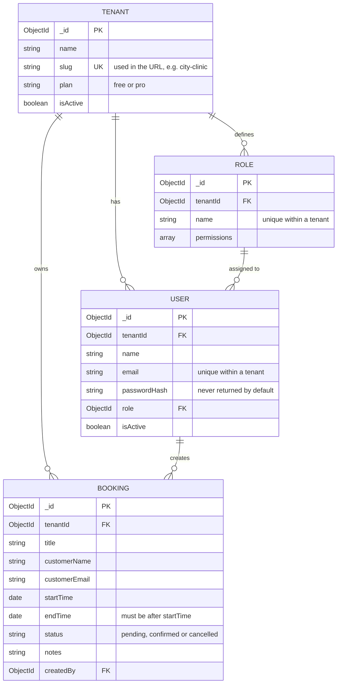
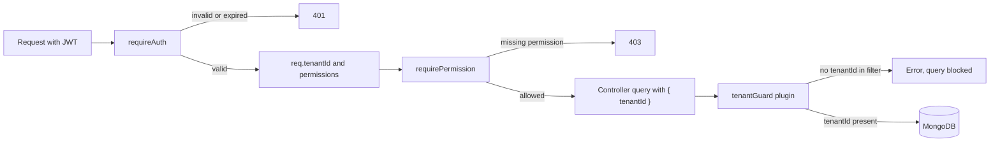

# Tessera

A multi-tenant booking platform for small businesses like clinics, salons and gyms. Each business gets its own private space for its team and bookings, all running on one shared app.

Built during the Parallax Labs Full-Stack Developer Internship (Track B, 6 weeks).

## Why the name "Tessera"

A **tessera** is a single tile in a mosaic. Hundreds of them sit side by side to make one picture, but each tile stays whole and separate.

That's exactly how this app works:

- Every business on Tessera is one tile, with its own users, roles and bookings
- All the tiles together make up the platform
- No tile can see into another, which is the core idea of multi-tenancy

The visual design follows the same idea. The tile pattern on the auth screens is inspired by **ajrak**, the hand block-printed textile from Sindh, where a single carved block is stamped again and again to build the full pattern. On the Create organisation screen, one tile stays lit as "your tile" while you set up your business.

## Tech stack

- **Frontend:** React (Vite), React Router, Tailwind CSS v4, Zod
- **Backend:** Node.js, Express 5, Mongoose, Zod, JSON Web Tokens, bcryptjs
- **Database:** MongoDB 7, running in Docker
- **Tooling:** Docker Compose, nodemon

## Week 1: what I built

- MERN project with separate `client` and `server` apps in one repo
- MongoDB running in Docker Compose with persistent storage
- Environment variable validation with Zod on server startup
- Multi-tenant schema: Tenants, Roles, Users and Bookings
- Seed script with three realistic organisations, including cross-tenant test cases
- Tenant isolation enforced at the database layer with a Mongoose guard plugin
- Role-based access control with permission lists per role
- Auth API: organisation onboarding, member registration and login with JWT
- Responsive auth UI: Sign in, Create organisation, Join organisation and Reset password, all with client-side validation
- A bookings dashboard that shows only the signed-in organisation's data
- An isolation verification script that anyone can run

## How I approached it

**Isolation in code, not by trust.** MongoDB has no row-level security like PostgreSQL, so isolation has to live in the application. Instead of relying on every developer remembering to filter by tenant, I wrote a Mongoose plugin (`tenantGuard`) that runs before every query on tenant-owned models. If a query has no `tenantId`, it throws an error and never reaches the database. A forgotten filter becomes a visible error, not a silent data leak.

**The tenant comes from the token, never from the request.** When a user logs in, their JWT carries their `tenantId`. The auth middleware verifies the token, loads the user from the database and attaches `req.tenantId`. Routes use that value, so a user can't pick a different tenant by changing the URL or request body.

**Cross-tenant requests look like missing data.** If City Clinic sends the ID of a Glow Salon booking, the query includes both the booking ID and the clinic's `tenantId`, so nothing matches and the API returns `404`. It never confirms the booking exists.

**Email is unique per tenant, not globally.** The same person can work at two businesses with the same email and have two separate accounts. Login asks for the organisation URL first, like choosing a Slack workspace.

**Roles hold permissions.** Instead of checking "is this user an admin?" all over the code, each role has a list like `bookings:read` or `bookings:delete`, and routes check for the specific permission they need. Adding a new role later means adding a list, not changing code.

**Safe onboarding without transactions.** Creating an organisation makes a tenant, two roles and the first admin. MongoDB transactions need a replica set, so instead the onboarding handler deletes the tenant and roles if any later step fails, so no half-created organisations are left behind.

**Same login error for every failure.** Wrong organisation, wrong email or wrong password all return "Invalid organisation, email or password", so nobody can use the login form to find out which accounts exist. The password reset screen follows the same rule.

## Data model

Every model except Tenant carries a `tenantId`. That field is the isolation boundary.



Indexes:

- `Tenant.slug` is unique across the platform
- `Role (tenantId, name)` is unique, so every tenant has its own "admin" and "member"
- `User (tenantId, email)` is unique, so the same email can exist in different tenants
- `Booking (tenantId, startTime)` keeps "this tenant's bookings by date" fast

## Tenant isolation boundaries

Every protected request passes through these layers before touching data:



- **`requireAuth`** checks who is asking and which tenant they belong to
- **`requirePermission`** checks what their role allows
- **`tenantGuard`** is the last line of defence, so even a buggy route can't read another tenant's data

## Getting started

### Prerequisites

- Node.js 20 or higher
- Docker Desktop (running)
- Git

### 1. Clone and start MongoDB

```bash
git clone https://github.com/UroojFatima-052/parallax-saas.git
cd parallax-saas
docker compose up -d
```

### 2. Set up the backend

```bash
cd server
npm install
cp .env.example .env
```

On Windows CMD, use `copy .env.example .env` instead of `cp`.

Generate a secret for `JWT_SECRET` and paste it into `server/.env`:

```bash
node -e "console.log(require('crypto').randomBytes(32).toString('hex'))"
```

Fill the database with test data and start the server:

```bash
npm run seed
npm run dev
```

The API runs at `http://localhost:5000`. Check `http://localhost:5000/api/health`.

### 3. Set up the frontend

In a second terminal:

```bash
cd client
npm install
cp .env.example .env
npm run dev
```

Open `http://localhost:5173`.

## Test accounts

All seeded users have the password `Password123!`.

- **City Clinic** (`city-clinic`): `ayesha@cityclinic.test` (admin), `bilal.ahmed@mail.test` (member), `sana@cityclinic.test` (member)
- **Glow Salon** (`glow-salon`): `mehwish@glowsalon.test` (admin), `rabia@glowsalon.test` (member)
- **FitZone Gym** (`fitzone-gym`): `danish@fitzone.test` (admin), `bilal.ahmed@mail.test` (member)

The seed includes two cross-tenant cases on purpose:

- **Shared staff:** Bilal works at City Clinic and FitZone Gym with the same email. He has two separate accounts, and the organisation he signs into decides what he sees
- **Shared customer:** Fatima Noor has a blood test at City Clinic and a facial at Glow Salon. Each business only sees its own booking with her

## Verifying isolation

With the database seeded, run from `server`:

```bash
npm run verify
```

It checks that:

- A scoped query returns only that tenant's bookings
- Queries without a `tenantId` (`find`, `findById`, `deleteMany`) are blocked by the guard
- One tenant can't read another tenant's booking even with its exact ID
- The shared customer and shared staff cases stay separate

Expected output ends with `All isolation checks passed`.

## API endpoints

**Auth** (public)

- `POST /api/auth/onboard` creates an organisation, its roles and the first admin. Returns a token
- `POST /api/auth/register` joins an existing organisation as a member. Returns a token
- `POST /api/auth/login` signs in with organisation URL, email and password. Returns a token

**Bookings** (requires `Authorization: Bearer <token>`)

- `GET /api/bookings` lists the signed-in tenant's bookings. Needs `bookings:read`
- `DELETE /api/bookings/:id` deletes a booking in the signed-in tenant. Needs `bookings:delete`, so members get `403`

**Other**

- `GET /api/health` returns `{ "status": "ok" }`

## Project structure

```
parallax-saas/
├── client/                    React frontend
│   └── src/
│       ├── api/               apiRequest helper
│       ├── components/        AuthLayout, AjrakPattern, FormField, SubmitButton, FormAlert
│       ├── pages/             Login, Onboard, Register, ResetPassword, Dashboard
│       └── utils/             validation, slugify, session
├── server/                    Express backend
│   └── src/
│       ├── config/            env validation, database connection
│       ├── controllers/       auth and booking logic
│       ├── middleware/        requireAuth, requirePermission
│       ├── models/            Tenant, Role, User, Booking
│       ├── plugins/           tenantGuard
│       ├── routes/            auth and booking routes
│       ├── seed/              seed and isolation verification scripts
│       └── utils/             JWT helpers
└── docker-compose.yml         MongoDB
```

## Known limitations

These are deliberate Week 1 trade-offs, planned for later weeks:

- **Open registration:** anyone who knows an organisation's URL can join it as a member. A real product would use invite links from an admin
- **Password reset is UI only:** the request screen works, but no email is sent yet
- **Token in localStorage:** simple to work with, but readable by JavaScript if the site ever had an XSS bug. An `httpOnly` cookie would be safer
- **No transactions:** onboarding cleans up manually on failure instead of using MongoDB transactions, which need a replica set
- **Subdomains are a preview only:** the `slug.tessera.app` address is shown in the UI, but routing by subdomain comes later

